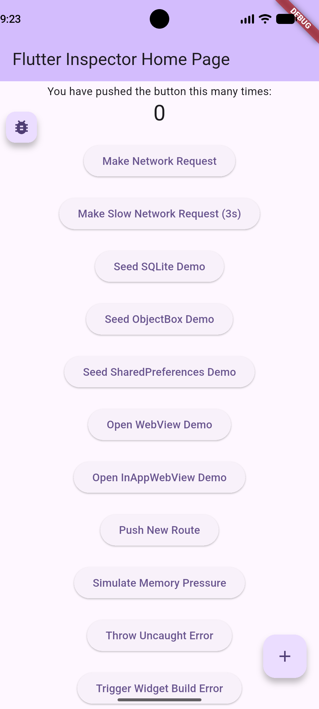
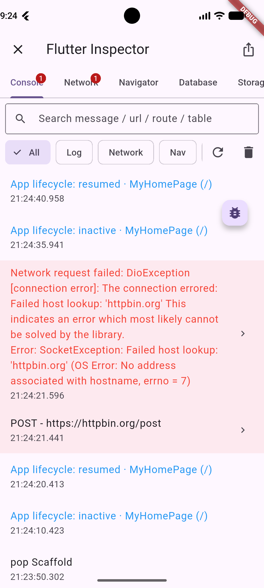
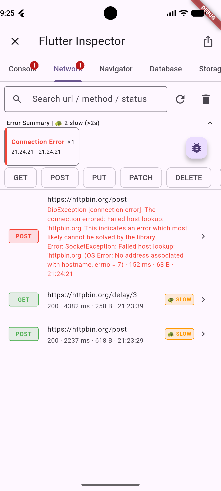
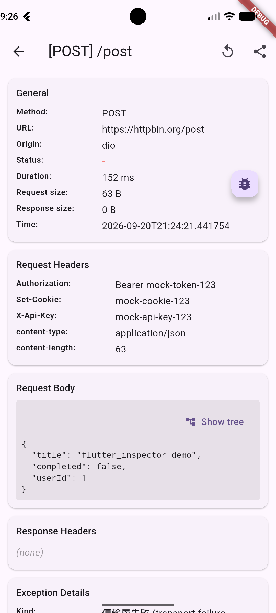
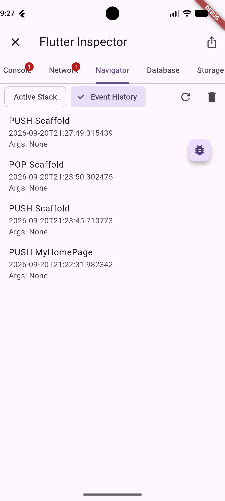
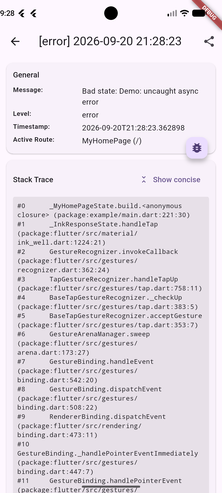
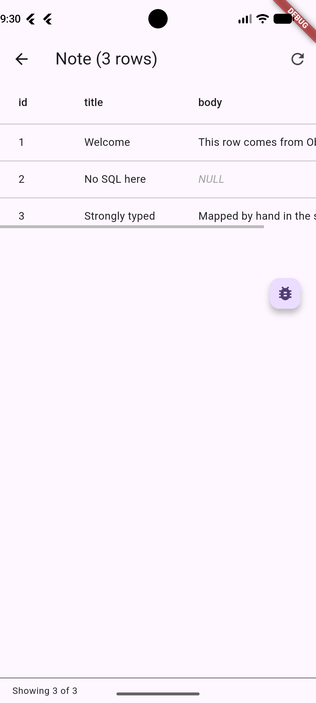
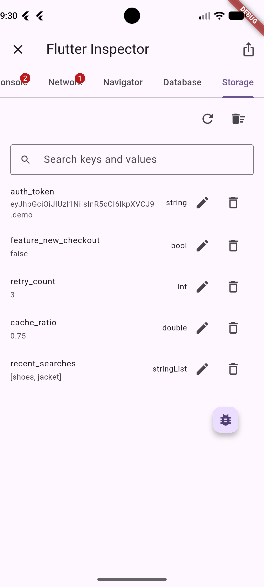
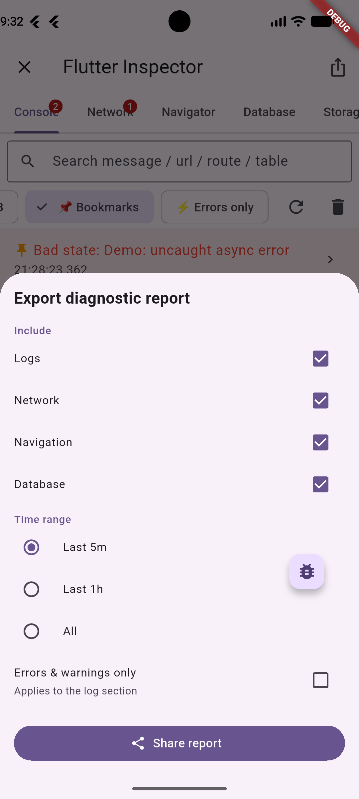
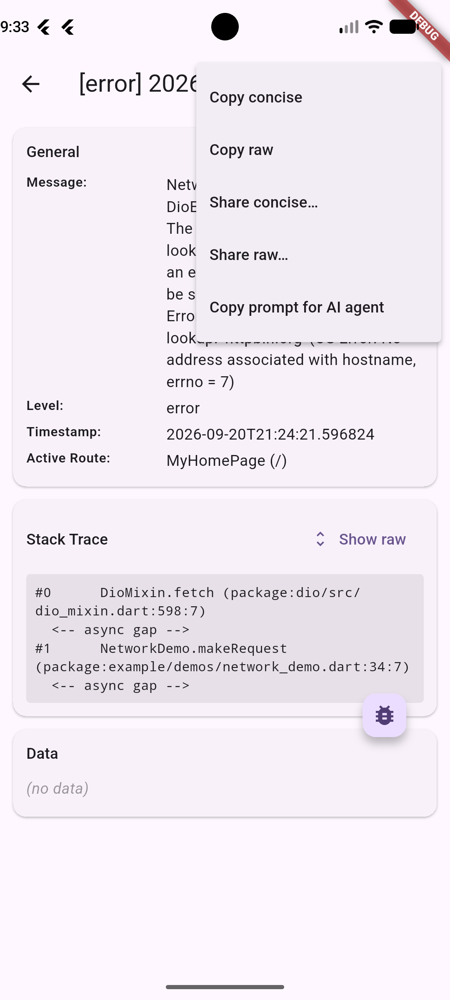

# 🔍 Flutter Inspector

[](https://pub.dev/packages/flutter_inspector_kit)
[](https://pub.dev/packages/flutter_inspector_kit)

**Language / 語言**: [English](README.md) | [繁體中文](README.zh-TW.md)

嵌入 App 內的多合一偵錯疊層工具，為 Flutter App 提供 logs、network、navigation 與 database 的檢視，全部收攏在單一統一 API 之後。

## 📦 功能

| 功能 | 說明 | 使用情境範例 |
|---|---|---|
| 🪵 **Console** | 擷取五種嚴重程度（`verbose` / `debug` / `info` / `warning` / `error`）的 log，可選帶結構化資料與 stack trace；stack trace 預設以精簡（concise）形式顯示，原始版本一鍵可切 | QA 回報「點結帳沒反應」——打開 Console，在時間軸上一眼看到紅色錯誤項目；點進去查看結構化錯誤細節、response body，以及已摺疊框架噪聲的 stack trace，讓自家程式碼的 frame 是你最先讀到的東西 |
| 📌 **時間軸書籤** | 長按時間軸上的任何項目即可加上視覺標記，並能快速篩選僅顯示被標記的項目 | 在捲動數百行 log 時發現可疑請求？將其加入書籤，切換「Bookmarks」chip 即可將其與其他關鍵事件一起孤立檢視，不會在時間軸中迷失位置 |
| 🧵 **合併時間軸（Merged Timeline）** | Console 分頁把 logs、network、navigation 與 database 事件交錯排在同一條依時間戳排序的時間軸上，並提供各來源的 filter chip；error 等級的 log 與失敗的 network 呼叫會帶淡紅底色，捲動長時間軸時一眼就能認出 | 延續結帳案例——把來源 chip 切到「All」，沿時間軸往回捲，檢視那個拿到 401 的請求：看 `Authorization` header 帶了什麼 token、送了哪些參數，和後端預期比對，精準定位伺服器為何拒絕——全程不用切分頁或手動比對時間戳 |
| 📡 **Network** | 透過 Dio 攔截 HTTP 流量；檢視結構化的 request/response 細節；依 URL、method 或 status 搜尋／篩選；以 cURL 分享 | 某個頁面整片空白——打開 Network 分頁發現 API 回了錯誤，所以根本沒資料可顯示；點進去檢視 request 參數與 response body，再複製成可直接執行的 cURL 指令，貼進 bug ticket 讓後端團隊重現 |
| 🌳 **JSON 樹狀檢視（JSON Tree Viewer）** | Network 的 request/response body 與結構化 log `data` 均以可收合樹狀圖呈現——容器大小直接標示、預設展開前兩層、長按任一行即可複製其 `path: value`；大資料量時會顯示搜尋欄，並附 raw/tree 切換按鈕以切回可選取的純文字 | 200 行的 response body 藏著你需要的欄位——收合無關分支，或在搜尋欄輸入 key，直接展開祖先鏈找到匹配項，不必再人肉捲動長篇 JSON |
| 🔄 **Network Replay** | 用原始的 Dio 實例重送一個已擷取的請求（沿用相同 headers、base URL、interceptors）；重送的項目會自動標記，且在確認提示中直接顯示結果狀態碼（`Resent → 500`）或失敗類型（`Resend failed: connectionError`） | 在裝置上重觸一個失敗的 API 呼叫，驗證伺服器端的 hotfix，不必重啟 App 或重走一遍使用者流程 |
| 🐢 **慢請求標記（Slow Request Indicator）** | 超出可自訂時間門檻的 Network 請求會在 Network 與 Console 分頁被加上 `🐢 SLOW` 視覺標記——包括仍在等待回應的請求（會顯示 `no response · 12s`） | 輕鬆找出拖慢 App 的 endpoint，不必手動翻找 log 即可定位效能瓶頸 |
| 🚨 **結構化網路錯誤（Structured Network Errors）** | 失敗的請求會顯示 **Exception Details** 區塊，區分傳輸層失敗（裝置離線／DNS／逾時）與伺服器端錯誤（4xx/5xx），並附可複製的 stack trace | 立刻分辨「Failed」到底是裝置斷線還是伺服器回了 500——QA 期間不必再靠猜 |
| 📊 **錯誤聚合摘要（Error Aggregation Summary）** | Network 分頁會顯示一個可收合的橫幅，依 status code（傳輸層失敗則依 error type）將失敗／錯誤的請求分組，附各組計數與時間範圍；點某一組即把呼叫列表篩選到只剩該錯誤 | 頁面被幾十筆失敗呼叫灌爆——瞄一眼摘要橫幅看到「12× 401」「3× timeout」，點 401 那組就把那些呼叫獨立出來，不必在整份列表裡捲來捲去 |
| 🩺 **診斷報告（Diagnostic Report）** | 匯出單一份 Markdown 報告——裝置／App 標頭、當前 route stack，以及 logs / network / navigation / database 各區段——可依時間窗（5m / 1h / all）、來源與可選的僅錯誤開關篩選；直接送進分享面板，不寫入磁碟 | QA 重現 bug 後，不用截四個分頁的圖再手打 OS 版本，按一次 Export 就把完整報告貼進 Jira ticket |
| 🌐 **WebView 行內偵錯（WebView Inline Debugging）** | 把 WebView 自身的 `console.*`、`window.onerror`/`unhandledrejection` 與 `fetch`/`XMLHttpRequest` 活動橋接進與原生 log、Dio 流量共用的同一個 Console 與 Network 分頁——零相依，自行把你的 `webview_flutter` 或 `flutter_inappwebview` 接到 `WebViewBridgeAdapter` | 混合式頁面出狀況，你分不清 bug 在 Flutter 還是內嵌網頁——直接在 Console/Network 內看到 WebView 的 JS 錯誤與 `fetch`/`XHR` 呼叫，並依 origin 標記，立刻知道該修哪一側，不必把 Chrome DevTools 掛到 WebView 上 |
| 🛡️ **敏感資料遮罩（Sensitive-Data Redaction）** | 預設即安全——敏感 headers（`Authorization`、`Cookie`、`Set-Cookie`、`X-Api-Key`）與敏感路由參數（`token`、`password`、`pin`、`apiKey` 等）在每一條分享／匯出路徑上都會被遮罩 | 放心把 network log 分享給隊友或附進 Jira ticket，不會外洩 token 或 session cookie |
| 🧭 **Navigator** | 自動追蹤 route 的 push、pop 與 replace；可在 **Event History**（原始 log）與 **Active Stack**（即時 route-stack 視覺化）之間切換。每個事件都會記錄其 URL query 參數與 route arguments，顯示為 **Params** / **Args**；在 Console 點選導航項目即可將其展開為 JSON 樹狀檢視。dashboard 自身的 route 會被濾掉，查 bug 不會反過來污染這份歷史 | 驗證 deep-link 路由、確認 back-stack 正確性，或在 QA 走查時診斷「使用者為什麼會落到這個畫面？」——直接查看開啟詳情頁所帶的 `id`，不必再從 route 名稱盲猜；且因點開詳情頁不寫入歷史，翻查十分鐘後看到的 stack 依然是你 App 的真實軌跡 |
| 🗄️ **Database** | 記錄 insert / update / delete / query 操作，含受影響筆數與 payload；透過可插拔的 `DatabaseBrowserSource` 瀏覽真實資料表（已提供 SQLite / ObjectBox adapter） | 驗證「儲存」動作是否真的寫進預期的資料列；在裝置上直接瀏覽本地 SQLite 資料表，不必把 `.db` 檔拉出來 |
| 🔑 **Storage** | 透過可插拔的 `KeyValueBrowserSource` 瀏覽、編輯、刪除或批次清空 key-value 儲存（提供 SharedPreferences / SecureStorage adapter 範例）；每次寫入均需二次確認，成功的寫入皆會留下稽核 log | 檢查過期的 token 或卡住的 feature flag 是否是 bug 的根源——直接在裝置上清除，無需使用 adb shell |
| 🧵 **可讀的 Stack Trace** | 框架內部 frame 摺疊為 `[... N frames of framework internals]`（保留頭尾邊界 frame），非同步中斷點顯示為 `<-- async gap -->`；raw／concise 可一鍵切換，分享選單則可各自明確匯出兩種形式 | 一個未捕捉錯誤吐出 40 行 `package:flutter/…`，把真正重要的兩行自家程式碼淹沒——concise 版本讓你不用捲動就看到自己的 frame，需要完整堆疊時再一鍵切回 raw |
| 🧭 **Log Route 脈絡** | 每筆 log 都記錄寫入當下最上層的頁面，顯示於詳情頁與匯出內容 | 同樣一則「token refresh failed」，發生在結帳頁與發生在背景刷新是兩回事——記錄下來的 route 讓你事後讀時間軸時分得出來 |
| 🤖 **Agent Handoff 提示詞** | 將任何 log 或 network 項目複製為給 coding agent 的 Markdown prompt——包含事件自身資訊、stack trace，以及*稍早在同一 route 上發生的其他事件*（依使用者停留該頁面的期間走訪，而非固定時間窗） | 找到出錯的 API 呼叫但不知道如何修復——複製提示詞並貼給你的 agent，帶齊同頁面前置脈絡，並明確註明原因未知，避免 agent 誤把出錯行當作根本原因 |
| 🛑 **未捕捉錯誤擷取（Uncaught Error Capture）** *(需 opt-in)* | 透過三個 Flutter hook（build/layout/paint、async、`ErrorWidget`）自動把未捕捉的錯誤轉成 `error` 等級的 Console log；串接既有 handler——絕不吞錯。RenderFlex overflow 會帶有溢出尺寸與方向標記，詳情頁亦會標示造成錯誤的 widget 與原始碼位置 | 某個未 await 的 `Future` 在第三方套件深處拋錯——附近完全沒有 `try/catch`。Uncaught error capture 自動連同完整 stack trace 記錄下來，不用手動埋點 |
| ⏱️ **App 生命週期標記（App Lifecycle Markers）** *(需 opt-in)* | 把每一次 `resumed` / `inactive` / `paused` / `detached` 轉換記錄成 `info` 等級的 Console log，各自標註當下最上層的頁面，並交錯進合併時間軸 | 一批請求以 timeout 失敗，在辦公桌前卻怎麼都重現不了——翻時間軸，`App lifecycle: paused · CheckoutPage` 這筆就卡在它們前面，代表使用者切走了、OS 把網路凍結，根本不是後端的問題。反過來也好用：確認「回到前景就刷新」真的有觸發，而且是在哪一頁觸發 |
| 🧊 **凍結幀捕捉（Frozen Frame Capture）** *(需 opt-in)* | 將每次渲染耗時達 700ms 或以上的幀（Android vitals 的凍結幀定義）記錄為 `warning` 等級的 Console log，附 wait / build / raster 細項拆解；連續凍結幀會自動合併為單一項目 | 開啟訂單列表後 App「卡頓了一秒」——時間軸在 2 MB JSON 回應後隨即顯示 `Frozen frame (1240ms) · OrderListPage`，確認停頓點發生在 UI 執行緒的資料解析，而非網路端 |
| 🔔 **即時通知（Live Notification）** *(需 opt-in)* | 一則系統通知摘要最新一筆 API 呼叫與累計總數；點一下直接跳到 Network 分頁 | 在 App 內導覽時即時監看 API 流量——不必一直開著 dashboard；也適合驗證每個操作的 API 呼叫數是否合理（例如單一頁面載入就觸發數十筆呼叫，暗示有重複請求） |
| 📐 **佈局邊界疊層（Layout Boundary Overlay）** *(僅 debug)* | dashboard app bar 上的格線按鈕可切換 Flutter 的佈局邊界疊層（`debugPaintSizeEnabled`）並立即重繪 App；在 debug 以外的環境自動隱藏 | 小螢幕上排版溢出——從 dashboard 快速切換疊層，在真實螢幕上檢視每個 widget 的外框與 padding，不必修改程式碼或開啟 DevTools |
| 🎯 **點選與拖曳佈局檢查（Tap-to-Inspect Layout）** | 點選任何 widget 檢視其尺寸、constraints 與螢幕位置，沿父級鏈向上走訪，並將整條鏈複製或分享為文字；小尺寸目標可按住並拖曳瞄準，手指上方（近頂部邊緣則在下方）顯示放大鏡與十字準星；點選尺規圖示以 dp 和 px 雙單位測量與另一個 widget 的距離與間距；支援 release 模式 | 按鈕在 QA 裝置上被壓扁——點它查看 `constraints: 0.0 ≤ h ≤ 20.0`，向上走訪找到施加 20px 限制的父級，將精確數值貼進 bug ticket；透過十字準星瞄準手指遮蔽的 16×16 圖示；點選尺規驗證頭像與使用者名稱間距是否符合設計稿 12dp 規格 |
| 👆 **神奇點擊與浮動按鈕（Magical Tap & Floating Button）** | 用隱藏的多次點擊手勢，或可拖曳的 App 內 FAB 打開 dashboard | 內嵌進 release build 作為隱藏的診斷入口——當 QA 或使用者遇到問題，當場觸發 inspector 做初步錯誤分流，不必重建 debug 版或翻原始碼 |
| 🧩 **自訂分頁（Custom Tab）** | 透過 `FlutterInspector(customTab: ..., customTabTitle: ...)` 注入你自己的 widget 作為第 5 個 dashboard 分頁——與 Console / Network / Navigator / Database 並列 | 把 App 專屬的偵錯工具擺在內建 inspector 旁邊——feature-flag 開關面板、當前 auth/session 狀態、或「清快取」按鈕——讓團隊的臨時診斷全集中在一處，不必另開一個 debug 畫面 |

## 📱 螢幕截圖

|Home|Console|Network|
|---|---|---|
||||

|Network Detail|Navigator|Uncaught Error|
|---|---|---|
||||

|Database Browse|Storage|Diagnostic Report|
|---|---|---|
||||

|Info Sharing|||
|---|---|---|
||||

## 🪚 使用方式

### 加入 pubspec.yaml

```yaml
dependencies:
  flutter_inspector_kit: ^2.9.0
```

接著執行 `flutter pub get`。

### 初始化

建立單一個共用的 `FlutterInspector` 實例並接進你的 App。`navigatorKey` 是**必填**的——inspector 透過它路由到 dashboard——所以請建立一把 key，傳給 inspector，並把**同一把 key** 也傳給你的 `MaterialApp`。接著註冊 navigator observer 以追蹤 route，並用 `FlutterInspectorMagicalTap` 包住你的 App，讓隱藏手勢能從任何地方打開 dashboard。

```dart
import 'package:flutter/material.dart';
import 'package:flutter_inspector_kit/flutter_inspector_kit.dart';

// 1. 一把 key，inspector 與 MaterialApp 共用。
final navigatorKey = GlobalKey<NavigatorState>();

final inspector = FlutterInspector(
  // 必填：dashboard 透過這把 key 開啟。
  navigatorKey: navigatorKey,
  // 選填：設定判定為「🐢 SLOW」的門檻（預設 2 秒）
  slowRequestThreshold: const Duration(seconds: 3),
);

void main() => runApp(const MyApp());

class MyApp extends StatelessWidget {
  const MyApp({super.key});

  @override
  Widget build(BuildContext context) {
    return MaterialApp(
      // 2. 同一把 key——少了這行，dashboard 就沒有可開啟的 context。
      navigatorKey: navigatorKey,
      // 3. 追蹤導航事件
      navigatorObservers: [inspector.navigatorObserver],
      // 4. 隱藏手勢可從任何地方打開 dashboard
      builder: (context, child) {
        return FlutterInspectorMagicalTap(
          onTap: () => inspector.openDashboard(),
          child: child ?? const SizedBox.shrink(),
        );
      },
      home: const MyHomePage(),
    );
  }
}
```

就這樣？對，就這樣。

> **兩個步驟缺一不可。** `navigatorKey` 在建構子上是編譯期強制的，但「有沒有傳給 `MaterialApp`」編譯器檢查不到。漏了第二步，這把 key 永遠拿不到已掛載的 context，`openDashboard()` 就會靜默無反應——不論是 magical tap、浮動按鈕，還是點通知都一樣。

### Floating button

偏好看得見的觸發方式？在第一幀建立後 attach inspector，顯示一顆可拖曳、點了會打開 dashboard 的浮動按鈕。

```dart
@override
void initState() {
  super.initState();
  WidgetsBinding.instance.addPostFrameCallback((_) {
    inspector.attach(context: context);
  });
}
```

用 `inspector.detach()` 即可再次移除。

### 檢視元件尺寸與約束（Inspect layout）

點選 dashboard app bar 上的 **Inspect layout** 按鈕。dashboard 將會關閉，接著在 App 畫面上點選即可選取手指下方的 widget：其外框會被標亮，並以卡片顯示該 widget 與 render object 型別、`size`、`constraints` 以及螢幕座標位置。使用上下箭頭走訪父級元件鏈——壓扁 widget 的約束通常來自其祖先——並可將整條鏈複製或分享為純文字附在 bug ticket。點選其他區域可選取不同 widget，關閉卡片即可返回 App。

針對 16×16 圖示等細小目標，請按住並拖曳代替單純點擊。當手指移動超出防誤觸範圍時，手指上方（靠近螢幕頂部時則會自動翻轉至下方）會顯示帶有十字準星的放大鏡，外框與卡片會隨十字準星瞄準的目標即時跟隨。放開手指即可選定目標；其結果與直接點擊該點完全等價。使用滑鼠時，漂移數像素的點擊亦會短暫出現放大鏡。Web 平台不支援放大鏡，但拖曳瞄準依然可用。

若要測量 widget 之間的相對距離與間隙，點選卡片上的 **Measure distance** 尺規按鈕。這會將當前 widget 鎖定為參考基準 **A**（藍色外框）。點選其他 widget 即可選定目標 **B**（橘色外框），即時繪製尺規輔助線與距離標籤，並以雙單位顯示：邏輯像素（`dp`）與物理螢幕像素（`px`）。在目標 B 上仍可使用上下箭頭走訪其父容器以測量與容器間的 padding，複製或分享時也會包含完整的間距測量數據。再次點選尺規按鈕即可退出測量模式。

此功能零配置，支援包含 release 在內的所有建置模式。數據均為點選或放開瞬間的快照；若佈局發生變動，請重新選取。此模式不會在時間軸寫入任何資料。在 profile 與 release 模式下，卡片會提示型別名稱可能已被混淆（當 App 以 `--obfuscate` 建置時）。

### 加入自訂分頁

注入你自己的 widget 作為第 5 個 dashboard 分頁，與內建的 Console / Network / Navigator / Database 分頁並列。用它來呈現 App 專屬的診斷內容——feature-flag 面板、當前 auth 狀態、「清快取」按鈕等等。

```dart
final inspector = FlutterInspector(
  navigatorKey: navigatorKey,
  customTab: const MyDebugPanel(),
  customTabTitle: 'Flags', // 預設為 'Custom'
);
```

該 widget 會在其分頁首次顯示時才 lazy 建立，可以是任何 Flutter widget——包括自帶 controller 的 stateful widget。

### 記錄 network 請求

#### 搭配 Dio

把 interceptor 加進你的 `Dio` 實例，每一筆 request/response 就會自動被擷取。傳入 `sourceDio` 實例即可在 Network 詳情頁啟用 **Resend (Replay)** 功能。

```dart
final dio = Dio();
dio.interceptors.add(FlutterInspectorDioInterceptor(inspector, sourceDio: dio));
```

##### 多個 Dio 實例

若你的 App 使用多個 `Dio` 實例（例如 `authDio` 給需要認證的 API 呼叫、`publicDio` 給公開資源），請在每個實例上都註冊 interceptor，並確實把各自對應的實例當作 `sourceDio` 傳入：

```dart
// Authenticated API client
final authDio = Dio();
authDio.interceptors.add(FlutterInspectorDioInterceptor(inspector, sourceDio: authDio));

// Public API client
final publicDio = Dio();
publicDio.interceptors.add(FlutterInspectorDioInterceptor(inspector, sourceDio: publicDio));
```

這能保證在 Network 詳情頁重送請求時，用的是完全相同的 `Dio` 實例，維持正確的 baseUrl、interceptors 與認證狀態。

#### 搭配其他 HTTP client

自行建立 `NetworkEntry` 並傳入：

```dart
inspector.logNetwork(entry);
```

若要顯示一個進行中、稍後才 resolve 的請求，先記錄 pending 項目，等 response 回來後再用 `replaces` 記錄完成的項目，讓它就地更新而非重複：

```dart
final pending = inspector.logNetwork(NetworkEntry(method: 'GET', url: url));
// ...after the response arrives:
inspector.logNetwork(completedEntry, replaces: pending);
```

#### 搭配 gRPC (`ClientInterceptor`)

針對使用 `package:grpc` 的 gRPC 服務，繼承 `ClientInterceptor` 把 unary RPC 呼叫記錄到 Network 分頁（streaming 呼叫透過基底類別直接透傳）：

```dart
import 'dart:convert';

// 需要在 App 的 pubspec.yaml 中引入 `grpc` 與 `protobuf`。
import 'package:grpc/grpc.dart';
import 'package:protobuf/protobuf.dart';
import 'package:flutter_inspector_kit/flutter_inspector_kit.dart';

class FlutterInspectorGrpcInterceptor extends ClientInterceptor {
  FlutterInspectorGrpcInterceptor(this.inspector);

  final FlutterInspector inspector;

  @override
  ResponseFuture<R> interceptUnary<Q, R>(
    ClientMethod<Q, R> method,
    Q request,
    CallOptions options,
    ClientUnaryInvoker<Q, R> invoker,
  ) {
    // 1. 記錄 pending 呼叫
    final pending = inspector.logNetwork(
      NetworkEntry(
        method: 'gRPC',
        url: method.path,
        requestHeaders: options.metadata,
        requestBody: _encode(request),
      ),
    );

    final ResponseFuture<R> responseFuture;
    try {
      responseFuture = invoker(method, request, options);
    } on Exception catch (e, st) {
      // 下游攔截器可能拋出同步例外：記錄並向上拋出
      _logFailure(pending, e, st);
      rethrow;
    }

    // 2. 結算 pending 項目；呼叫端依然取得原始 future
    _settle(responseFuture, pending);
    return responseFuture;
  }

  Future<void> _settle<R>(ResponseFuture<R> future, NetworkEntry pending) async {
    try {
      final response = await future;
      // copyWith 保留 pending.timestamp（請求發起時間）
      inspector.logNetwork(
        pending.copyWith(
          duration: DateTime.now().difference(pending.timestamp),
          isComplete: true,
          responseBody: _encode(response),
        ),
        replaces: pending,
      );
    } on Exception catch (e, st) {
      _logFailure(pending, e, st);
    }
  }

  void _logFailure(NetworkEntry pending, Exception e, StackTrace st) {
    // gRPC 狀態碼應放入 headers，絕不可放入 statusCode（參見陷阱說明）
    inspector.logNetwork(
      pending.copyWith(
        duration: DateTime.now().difference(pending.timestamp),
        isComplete: true,
        error: e is GrpcError ? '[${e.codeName}] ${e.message ?? e}' : '$e',
        errorStackTrace: st.toString(),
        responseHeaders: e is GrpcError ? {'grpc-status': '${e.code}'} : null,
      ),
      replaces: pending,
    );
  }

  // Proto3 JSON 能在 Network 詳情頁中渲染為樹狀圖；
  // protobuf 的 toString() 是純文字格式而非 JSON。
  String _encode(Object? message) => message is GeneratedMessage
      ? jsonEncode(message.toProto3Json())
      : '$message';
}
```

在建立生成的 gRPC client stub 時掛載：

```dart
final client = GreeterClient(channel, interceptors: [
  FlutterInspectorGrpcInterceptor(inspector),
]);
```

#### 搭配 WebSocket

WebSocket 連線為持久、雙向的串流，而非單次的 request-response 來回。推薦的做法是透過 `inspector.log` 將連線生命週期事件記錄到 **Console** 分頁：

```dart
// 需要在 App 的 pubspec.yaml 中引入 `web_socket_channel`。
import 'package:web_socket_channel/web_socket_channel.dart';
import 'package:flutter_inspector_kit/flutter_inspector_kit.dart';

final channel = WebSocketChannel.connect(Uri.parse(wsUrl));

// 連線建立：僅在握手實際完成時記錄
try {
  await channel.ready;
  inspector.log('WebSocket connected: $wsUrl');
} on Exception catch (e) {
  inspector.log('WebSocket connect failed: $e', level: LogLevel.error);
  return;
}

// 複用既有 listener：channel stream 為單一訂閱，切勿為了 logging 多加第二個監聽器
channel.stream.listen(
  onMessage,
  onError: (Object e) =>
      inspector.log('WebSocket error: $e', level: LogLevel.error),
  // closeCode / closeReason 來自伺服器的關閉 frame；
  // 若由客戶端主動關閉或連線無預警中斷時它們為 null。
  onDone: () => inspector.log(
    channel.closeCode == null
        ? 'WebSocket disconnected (no close frame from server)'
        : 'WebSocket disconnected: code=${channel.closeCode} '
            'reason=${channel.closeReason}',
  ),
);
```

#### 協定狀態碼與 NetworkOrigin 注意事項

當手動整合非 HTTP 或非 Dio 協定時，務必注意兩大關鍵陷阱：

1. **切勿將非 HTTP 狀態碼傳入 `NetworkEntry.statusCode`**：
   `NetworkEntry.isFailed` 判定失敗的規則為：
   ```dart
   bool get isFailed => (statusCode ?? 0) >= 400 || error != null || errorType != null;
   ```
   - **gRPC 狀態碼** 範圍為 `0` (OK) 至 `16` (UNAUTHENTICATED)。因為所有 gRPC 碼都 `< 400`，設定 `statusCode: error.code` 將**永遠不會**觸發 `isFailed`（取消或未認證的呼叫會被誤判為成功！）。
   - **WebSocket close codes** 正常關閉碼為 `1000` (`1000..4999`)。若放入 `statusCode`，`1000 >= 400` 為 `true`，會把正常斷線誤標為失敗！
   - 此外，Network 分頁的篩選 chip（`2xx`, `3xx`, `4xx`, `5xx`）期望標準 HTTP 狀態碼。
   - **解法**：非 HTTP 協定請保持 `statusCode` 為 `null`。錯誤說明傳入 `error:`（這會將 `isFailed` 設為 `true`），並把協定特定狀態碼記錄在 `responseHeaders`（例如 `{'grpc-status': '${error.code}'}`）或 body 中。

2. **切勿新增或期望自訂的 `NetworkOrigin` 列舉值**：
   `NetworkOrigin` 是公開列舉（`dio`, `webview`）。宿主 App 常會使用窮盡的 `switch (entry.origin)` 表達式。新增 `grpc` 或 `websocket` 等新值會在編譯期破壞窮盡比對（`Never break userspace`）。`origin` 沒有「unspecified」值，預設為 `NetworkOrigin.dio`，因此自訂項目在詳情頁的 Origin 欄位會顯示 `dio`。請視為目前 API 的已知限制（也不要設為 `webview`，那會造成標籤誤導）。

### 在 Network 分頁裡

- **搜尋與篩選**：依 URL、method 或 status code 篩選呼叫列表（不分大小寫）；method 與 status（`2xx`/`3xx`/`4xx`/`5xx`/`Failed`）chip 可再進一步縮小範圍。
- **錯誤摘要橫幅**：呼叫列表上方一個可收合的橫幅，依 status code（傳輸層失敗則依 error type——離線/逾時/DNS）將失敗／錯誤的請求分組，顯示各組計數與首見/末見時間範圍。點某張分組卡即把列表篩選到只剩該錯誤；再點一次即清除篩選。
- **呼叫細節**：點任一筆呼叫進入結構化檢視——General（method、URL、附色彩標示的 status、duration、request/response 大小）、Query Parameters、Headers，以及渲染為可收合樹狀圖的 JSON body（大 payload 支援搜尋，並附 **Show raw** 按鈕切回純文字）。非合法 JSON 的 body（被截斷、或 `Content-Type` 虛標）會自動退回純文字。被截斷的 body 會清楚標示。二進位 payload（`Uint8List`，如檔案下載）以 `[binary N bytes]` 佔位呈現而非逐 byte 編碼，且帶有二進位 body 的請求無法被重送。失敗的請求會顯示一個 **Exception Details** 區塊，區分傳輸層失敗與伺服器端錯誤，並附可複製的 stack trace。
- **分享**：把呼叫複製為可執行的 `cURL` 指令、把完整細節複製為文字，或開啟系統分享面板（原生透過 `share_plus`、web 透過瀏覽器 Web Share API——不可用時退回剪貼簿）。
- **Replay / Resend**：對於 interceptor 有提供 `sourceDio` 而擷取的請求，你可以在詳情頁觸發「Resend」動作，用同一個 Dio client（帶著相同 headers、base URL 與 interceptors）在本地重送請求。重送的請求會自動以帶「Replay」標籤的新項目出現，確認提示中直接顯示結果——收到回應時顯示狀態碼（`Resent → 200` / `Resent → 500`），未收到回應時顯示失敗類型（`Resend failed: <type>`，例如 `connectionError`, `receiveTimeout`）。
- **慢請求**：耗時達到或超過 `slowRequestThreshold` 的呼叫會在此處與 Console 帶有 `🐢 SLOW` 標記，摘要橫幅也會進行統計。仍在等待回應的請求會從送出當下開始計算時間——其資料列顯示 `no response · 12s`——因此永遠沒有回傳的呼叫也能被抓出。該 badge 在列表 rebuild 時計算，不依賴額外計時器。

### 遮罩敏感 headers

Network 詳情頁的每一條分享／匯出路徑——複製為 `cURL`、複製為文字、以及系統分享面板——**預設都會遮罩敏感 headers**，讓 secret 絕不外洩到剪貼簿、分享面板或截圖。被遮罩的 key 是 `Authorization`、`Cookie`、`Set-Cookie` 與 `X-Api-Key`（不分大小寫比對）；其值會被替換成 `••••`。

這由 `redactSensitiveData` 這個建構參數控制，預設為 `true`。以下兩種配置擇一使用。

預設即安全——敏感 headers 在分享／匯出的輸出中會被遮罩：

```dart
final inspector = FlutterInspector(navigatorKey: navigatorKey);
```

或選擇退出（例如需要原始值的內部建置版）：

```dart
final inspector = FlutterInspector(
  navigatorKey: navigatorKey,
  redactSensitiveData: false,
);
```

這個 flag 只影響分享／匯出的文字——dashboard 內即時顯示的 headers 永遠是真實值。

### WebView inline debugging

把 WebView 自身的 `console.*`、`window.onerror`/`unhandledrejection` 與 `fetch`/`XMLHttpRequest` 活動橋接進與原生 log、Dio 流量共用的同一個 Console 與 Network 分頁——多一個事件來源，不是另一套系統。本套件維持零相依：你自備 WebView 套件（`webview_flutter` 或 `flutter_inappwebview`），並自行把它接到 `WebViewBridgeAdapter`。

每種整合都遵循相同的三個步驟：

1. 建立 `final adapter = WebViewBridgeAdapter(inspector);`——一個透過 `inspector.log` / `inspector.logNetwork` 把橋接訊息轉成既有 `LogEntry` / `NetworkEntry` 物件的翻譯器。它不持有 buffer，自身也不做 redaction。
2. 把你的 WebView 套件的 channel/handler（以 `kWebViewBridgeChannelName` 常數命名，即 `'FlutterInspectorBridge'`）接到呼叫 `adapter.handleMessage(rawMessageString)`。
3. 把 `inspectorWebViewBridgeJs` payload 注入頁面——它會 hook `console.*`、`window.onerror`、`unhandledrejection`、`fetch` 與 `XMLHttpRequest`，並將每個事件以一個 JSON envelope 透過 channel 回傳。

#### 搭配 `webview_flutter`

```dart
final adapter = WebViewBridgeAdapter(inspector);
controller
  ..addJavaScriptChannel(
    kWebViewBridgeChannelName, // 'FlutterInspectorBridge'
    onMessageReceived: (m) => adapter.handleMessage(m.message),
  )
  ..setNavigationDelegate(NavigationDelegate(
    onPageStarted: (_) => controller.runJavaScript(inspectorWebViewBridgeJs),
  ));
```

可運作的 demo：[`example/lib/demos/webview_demo.dart`](example/lib/demos/webview_demo.dart)。

#### 搭配 `flutter_inappwebview`

```dart
final adapter = WebViewBridgeAdapter(inspector);
// AT_DOCUMENT_START 注入連頁面最早期的 log 也能抓到。
controller.addUserScript(userScript: UserScript(
  source: inspectorWebViewBridgeJs,
  injectionTime: UserScriptInjectionTime.AT_DOCUMENT_START,
));
controller.addJavaScriptHandler(
  handlerName: kWebViewBridgeChannelName,
  callback: (args) {
    // 網頁可以直接呼叫此 handler——轉發前請先驗證。
    final raw = args.isNotEmpty ? args.first : null;
    if (raw is String) adapter.handleMessage(raw);
  },
);
```

可運作的 demo：[`example/lib/demos/inappwebview_demo.dart`](example/lib/demos/inappwebview_demo.dart)。

#### 限制與 Gotchas

- **WebView 的 requests 無法重送**：只有由 Dio 處理的請求能透過 `sourceDio` 重新觸發。WebView 流量只供檢視。
- **Web 平台不支援**：此橋接仰賴原生 WebView 外殼；在 Flutter Web 上編譯為 no-op。
- **CSP 與沙盒**：注入的 script 與主頁面在同一個 execution context 中執行。嚴格的 Content Security Policy（CSP）若阻擋 inline scripts 或 restrict communications，可能會阻止 bridge 回傳訊息。
- **跨域 iframe**：瀏覽器同源政策（SOP）會阻止 script 存取跨域 iframe 內部的 `console` 或 `fetch`。
- **大 payload 效能**：橋接傳輸是同步透過 platform channel 進行。過度龐大的 response body 或極高頻的 log 可能會造成 UI 執行緒卡頓；建議在生產環境維持關閉。

### Live notification（需 opt-in）

在 App 於背景運作或於多畫面間切換時，在系統通知列保持常駐的 API 流量摘要。

它**預設停用**。在建構時啟用：

```dart
final inspector = FlutterInspector(
  navigatorKey: navigatorKey,
  showNotification: true,
);
```

> **僅支援原生平台。** 此功能使用 `flutter_local_notifications`，Web 建置時會排除它以維持 WASM 相容性。在 Web 上傳入此參數無效。
>
> Android 13+ (API 33+) 需要向使用者請求 `POST_NOTIFICATIONS` 權限。本套件**不會**自行觸發權限彈窗——請在你的 App 流程中適當的時機向使用者請求。

### 記錄 log 訊息

```dart
inspector.log('User tapped checkout');
inspector.log('User profile loaded', data: {'userId': 42, 'role': 'admin'});
inspector.log('Failed to save settings', level: LogLevel.error, stackTrace: trace);
```

可用的層級：`verbose`、`debug`、`info`、`warning`、`error`。

### 橋接既有 Logger

已經使用 [`logger`](https://pub.dev/packages/logger)、[`talker`](https://pub.dev/packages/talker) 或 [`logging`](https://pub.dev/packages/logging)？不必改動任何呼叫點。在 `main()` 建立 inspector 後掛上一個同步 hook，每一筆記錄就會化為 Console 時間軸上的**恰好一筆**項目，與 network、navigation 和 database 事件交錯排列。

本套件零相依：轉發程式碼位於你的 App 中，`flutter_inspector_kit` 絕不依賴這些函式庫。以下每種配方皆為可直接複製的單一檔案，加上一行接線程式碼。相同檔案已在 [`example/lib/bridges/`](example/lib/bridges/) 中編譯並通過測試（已驗證 logger 2.8.0、talker 5.1.20 與 logging 1.3.0）。

每個 hook 均置於該函式庫自身的過濾閘門之後，被捨棄的記錄不會到達時間軸：logger 為 `Logger.level` 或你的 `LogFilter`，talker 為 `TalkerFilter` 與 `enabled` 旗標，logging 為 `Logger.root.level`。talker 的 log level 為例外（參見其下方備註）。

#### `package:logger`

```dart
import 'package:flutter_inspector_kit/flutter_inspector_kit.dart';
import 'package:logger/logger.dart';

/// 將一筆 `logger` 事件轉發給 [inspector]，成為恰好一筆 log 項目。
///
/// 讀取結構化的 [OutputEvent.origin] 而非 printer 的 `lines`，
/// 確保 ANSI 色彩或外框字元不會進到 Console，且 stack trace 會落在可點擊的專屬欄位。
void forwardLoggerEvent(FlutterInspector inspector, OutputEvent event) {
  final origin = event.origin;
  final raw = origin.message;
  final message = '${raw is Function ? raw() : raw}';
  inspector.log(
    [message, origin.error].nonNulls.join('\n'),
    level: _toInspectorLevel(origin.level),
    stackTrace: origin.stackTrace?.toString(),
  );
}

// 使用門檻比對而非 switch：已廢棄的層級（verbose, wtf）能正確落入對應範圍，
// 且不會因直接寫出識別字而觸發 deprecated_member_use。
LogLevel _toInspectorLevel(Level level) {
  if (level >= Level.error) return LogLevel.error;
  if (level >= Level.warning) return LogLevel.warning;
  if (level >= Level.info) return LogLevel.info;
  if (level >= Level.debug) return LogLevel.debug;
  return LogLevel.verbose;
}
```

```dart
Logger.addOutputListener((event) => forwardLoggerEvent(inspector, event));
```

- 監聽器執行於 filter 與 printer 之後。預設的 `DevelopmentFilter` 在 release 建置會丟棄所有內容，因此在 release 也不會轉發任何記錄。
- 單一事件，單一項目：文字取自結構化的 `LogEvent`，而非 printer 輸出的字串行，因此 ANSI 顏色與方框不會進到 Console。自訂 printer 追加的前綴或類別名稱不會被轉發。
- 監聽器清單是全域靜態的，註冊一次即可。若重複註冊，每筆記錄會被轉發兩次。
- 若傳入 `Function` 形式的 message，bridge 與 printer 都會呼叫它（`PrettyPrinter` 與 `SimplePrinter` 皆然），因此每次事件可能執行兩次：請保持 lazy message 無副作用。若 bridge 呼叫時拋出例外，`logger` 會捕捉它並跳過該事件後續輸出。

#### `package:talker`

```dart
import 'package:flutter_inspector_kit/flutter_inspector_kit.dart' as kit;
import 'package:talker/talker.dart';

/// 將一筆 talker 記錄轉發給 [inspector]，成為恰好一筆 log 項目。
///
/// 供三個 [TalkerObserver] callback 共用：[TalkerError] 與 [TalkerException]
/// 也是 [TalkerData]，並自帶各自的層級。
void forwardTalkerData(kit.FlutterInspector inspector, TalkerData data) {
  final message = [
    data.message,
    data.exception,
    data.error,
  ].nonNulls.where((p) => '$p'.isNotEmpty).join('\n');
  inspector.log(
    message,
    level: _toInspectorLevel(data.logLevel),
    stackTrace: data.stackTrace?.toString(),
  );
}

// 窮盡式 switch：talker 未來新增的層級會在此處編譯報錯，而非靜默歸類。
// 未附帶層級的記錄在 talker 中視為 debug。
kit.LogLevel _toInspectorLevel(LogLevel? level) => switch (level) {
  LogLevel.error || LogLevel.critical => kit.LogLevel.error,
  LogLevel.warning => kit.LogLevel.warning,
  LogLevel.info => kit.LogLevel.info,
  LogLevel.debug || null => kit.LogLevel.debug,
  LogLevel.verbose => kit.LogLevel.verbose,
};

/// 將所有 talker callback 導向 [forwardTalkerData]。
///
/// talker 僅有單一 observer 欄位：若你已使用自訂 observer，
/// 請在其內部呼叫 [forwardTalkerData]，而非替換它。
class FlutterInspectorTalkerObserver extends TalkerObserver {
  FlutterInspectorTalkerObserver(this.inspector);

  final kit.FlutterInspector inspector;

  @override
  void onLog(TalkerData log) => forwardTalkerData(inspector, log);

  @override
  void onError(TalkerError err) => forwardTalkerData(inspector, err);

  @override
  void onException(TalkerException err) => forwardTalkerData(inspector, err);
}
```

```dart
final talker = Talker(
  observer: FlutterInspectorTalkerObserver(inspector),
);
```

- 若已配置自訂 observer，直接在其三個方法中呼叫 `forwardTalkerData(inspector, log)` 即可。
- **Talker 的 `settings.enabled` 與 `TalkerFilter`**：兩者皆先於 observer 執行。當 talker 被停用時，observer 不會被呼叫，因此也不會有內容轉發至 inspector。
- **記錄層級注意事項**：`TalkerData.logLevel` 僅由特定方法（`debug`、`info`、`warning`、`error`、`critical`）設定。透過未標記層級的方法（如 `handle`、`logTyped` 或自訂型別）產生的資料其 `logLevel` 為 `null`，會依 talker 慣例映射為 `LogLevel.debug`。若你的自訂型別實作了自有的層級概念，可在 `forwardTalkerData` 中先行比對。

#### `package:logging`

```dart
import 'package:flutter_inspector_kit/flutter_inspector_kit.dart';
import 'package:logging/logging.dart';

/// 將一筆 `logging` 記錄轉發給 [inspector]，成為恰好一筆 log 項目。
///
/// 格式化為 `[loggerName] message`，讓時間軸能辨識來源 logger，
/// 且 stack trace 與 error 物件會各自傳入專屬欄位。
void forwardLogRecord(FlutterInspector inspector, LogRecord record) {
  final header = record.loggerName.isEmpty ? '' : '[${record.loggerName}] ';
  final message = '$header${record.message}';
  final error = record.error == null ? null : '\n${record.error}';
  inspector.log(
    '$message${error ?? ''}',
    level: _toInspectorLevel(record.level),
    stackTrace: record.stackTrace?.toString(),
  );
}

// 使用門檻比對而非 switch：logging 允許自訂 Level 實例，
// 門檻比對可確保自訂數值落在預期的區間。
LogLevel _toInspectorLevel(Level level) {
  if (level >= Level.SEVERE) return LogLevel.error;
  if (level >= Level.WARNING) return LogLevel.warning;
  if (level >= Level.INFO) return LogLevel.info;
  if (level >= Level.CONFIG) return LogLevel.debug;
  return LogLevel.verbose;
}
```

```dart
Logger.root.onRecord.listen((record) => forwardLogRecord(inspector, record));
```

- `onRecord` 串流僅發布大於或等於 `Logger.root.level` 的記錄。調整 root level 即可同時控制 logging 與轉發行為。
- `Logger.root.onRecord` 支援多重訂閱，因此加入 listener 不會影響其他既有訂閱者（例如輸出到控制台的 listener）。
- `forwardLogRecord` 會在訊息前方加上 logger 名稱（`[AuthService] Login failed`），因為 `logging` 習慣建立命名 logger。若不需要此名稱，可直接省略。

### 讀取合併後的時間軸

Console 分頁會把 logs、network、navigation 與 database 事件依時間戳排序合併成單一時間軸。失敗的 network 呼叫與 `warning`/`error` 等級的 log 會以淡紅底色呈現。

上方提供 filter chip：
- **來源 chips**：`All`、`Logs`、`Network`、`Navigation`、`Database`。
- **等級 chips**：`Verbose`、`Debug`、`Info`、`Warning`、`Error`（僅過濾 log 項目，其他來源不受影響）。
- **`⚡ Errors only`**：跨來源隔離所有錯誤訊號（`warning`/`error` logs 與失敗的 network 呼叫）。
- **`Bookmarks`**：僅顯示長按加了書籤的項目。

點選處於篩選狀態下的任一行項目，即可清除所有篩選並自動捲動到未篩選時間軸上的該筆位置，方便查看上下文。

### 可讀的 Stack Trace

Flutter 原始 stack trace 大多數是 framework 內部細節。本套件在 Console 詳情頁中預設將連續的 `package:flutter/…` 與 `dart:…` frames 摺疊為單一標記：

```text
[... 18 frames of framework internals]
```

摺疊區段的第一個與最後一個 frame 會刻意保留，以清楚辨識自家程式碼與 framework 之間的交界點。非同步中斷處則明確標註為 `<-- async gap -->`。

詳情頁提供 **Show raw / Show concise** 切換開關，分享選單亦提供明確的匯出選項：
- **Copy concise** / **Copy raw**
- **Share concise** / **Share raw**

你也可以在程式碼中直接呼叫這些格式化工具：

```dart
// 取得精簡後的 stack trace 字串
final readable = normalizeStackTrace(rawTrace);

// log entry 的完整純文字匯出；預設為 concise。
final text = buildLogPlainText(entry);
final verbatim = buildLogPlainText(entry, isConcise: false);
```

### log 來自哪一頁

每筆 `LogEntry` 都會記錄寫入當下最上層的頁面，存放於 `activeRoute` 欄位——自動填入，不需要你這端做任何接線。它會顯示在 log 詳情頁與純文字匯出中。

```dart
inspector.log('Token refresh failed', level: LogLevel.error);
// entry.activeRoute == 'CheckoutPage'
```

同一則錯誤發生在結帳頁與發生在背景刷新，通常是兩個不同的 bug；事後回頭讀時間軸時，route 就是分辨兩者的依據。

### 把事件交給 Coding Agent（Agent Handoff Prompt）

Log 與 Network 詳情頁的分享選單中包含 **Copy prompt for AI agent** 操作。它會將你當前檢視的項目轉換為 Markdown 格式的 prompt，可直接貼給 coding agent。

該 prompt 包含四項關鍵資訊：
1. 明確聲明這是一筆執行期的觀察事實而非**診斷**，避免 agent 誤把出錯的 frame 當成有問題的根源；
2. 該項目自身的各項事實；
3. 其 stack trace（若有的話，採用 concise 形式）；
4. **稍早在同一 route 上發生的其他事件**——這通常是手動蒐集時最繁瑣的部分。

最後這部分會嚴格限制在使用者實際停留該 route 的區間內：往前回溯會在進入該頁面的時間點停止。無論頁面開啟 4 秒還是 4 分鐘，都能精準帶出屬於該次拜訪的事件，這是固定 `±n` 秒時間窗無法做到的。

Network 請求、Database 操作與 Log 皆會記錄當前所在的頁面，因此回溯支援跨來源串聯：

```dart
final inspector = FlutterInspector(
  // 針對長期停留頁面的安全上限（預設 50）。正常情況下回溯會在抵達 route 起點時提前結束。
  maxTraceBackEntries: 50,
);
```

當達到上限或緩衝區邊界時，prompt 輸出會明確註明，避免將不完整的歷史誤讀為完整紀錄。資料遮罩完全沿用 `redactSensitiveData` 設定。

> 提示詞刻意**不推測原因**。本套件擁有執行期事實但沒有你的程式碼庫；給出一個自信滿滿但錯誤的原因代價比不給更高，原因推導應交給能實際閱讀程式碼的 agent。
> 
> 提示詞內的資料會標註為 untrusted。response body 或 log 訊息可能含有類似 instruction 的文字，而 prompt 會直接貼入 agent 中。

### Uncaught error capture（需 opt-in）

預設情況下你得自己記錄錯誤。啟用 **uncaught error capture** 就能讓 inspector 自動把未捕捉的錯誤轉成 `error` 等級的 Console log——不需要手動 `try/catch`。

它**預設停用**，所以除非你主動要求，本套件絕不碰你的錯誤處理。在建構參數上啟用：

```dart
final inspector = FlutterInspector(
  navigatorKey: navigatorKey,
  captureUncaughtErrors: true,
);
```

這會接上三個標準 Flutter hook——`FlutterError.onError`（build/layout/paint 錯誤）、`PlatformDispatcher.instance.onError`（未捕捉的 async 錯誤，包含未 await 的 `Future` 錯誤）與 `ErrorWidget.builder`（哪個 widget build 失敗）。三者合起來涵蓋 framework、非同步與 build-time 錯誤，且不需要把 `runApp` 包進自訂 zone，所以沒有 `Zone mismatch` 要處理。

> **錯誤絕不會被吞掉。** 每個 hook 都是**串接/包住**你既有的 handler 而非取代它：inspector 記錄錯誤後就往下游轉發（你的 handler，或 Flutter 的預設呈現——debug 紅屏／release 灰屏維持不變）。這個擷取純粹是加法。

被擷取的錯誤會以紅色 log 出現在 **Console** 分頁。點任何帶 stack trace 或結構化資料的 log 即可打開詳情頁，內含可複製的 stack trace 與結構化 payload，並附複製／分享動作。

**RenderFlex overflows** 能從錯誤文字中精準辨識：Console 資料列會帶有溢出尺寸與方向的標記（例如 `Overflow: 200px right`），詳情頁則會顯示 Flutter 報出的 **Error Widget** 與 **Error Location** (`file:line:column`)，讓你無需翻閱整份報告就能直接定位肇事的 `Row` 或 `Column`。解析出的資訊亦保存在 log 的 `data` 欄位中（`overflowPixels`、`overflowDirection`、`errorCausingWidget`、`errorLocation`）。

#### 崩潰通知（Crash notifications，需 opt-in）

擷取到的錯誤亦可發出**系統通知**，以便在 App 處於背景或切換至其他畫面時立即察覺崩潰：

```dart
final inspector = FlutterInspector(
  navigatorKey: navigatorKey,
  captureUncaughtErrors: true,  // 必要條件——見下方說明
  showCrashNotification: true,
);
```

> **必須先設定 `captureUncaughtErrors: true`。** 若未掛載錯誤 hook 就沒有事件可通知，此時單獨設定 `showCrashNotification` 不會有任何作用。本套件刻意不自動替你開啟擷取開關——安裝全域錯誤處理器應由你決定。

崩潰通知獨立於 [網路通知](#live-notification需-opt-in)：它們擁有專屬的 notification id 與節流機制，因此**崩潰警告絕不會取代網路摘要**，突發的網路流量也不會壓抑崩潰警告。在 Android 上兩者使用獨立的通知管道（`flutter_inspector_crash`），可在系統設定中各自靜音。

**警告經過節流，而非每次錯誤跳一次。** 每個錯誤都會更新通知內容，但系統通知橫幅在 2 秒內最多只會彈出一次——連鎖錯誤爆發時只會發出一則提醒而非五十則。所有錯誤依然完整記錄在 Console 分頁。

不同於常駐的網路通知，崩潰通知是單一事件，可以滑動清除。**點擊通知會直接打開 dashboard 並定位在 Console 分頁**。

> **僅支援原生平台。** 依賴 `flutter_local_notifications`，Web 建置時會排除它以維持 WASM 相容性。在 Web 上設定此參數無效。

### App 生命週期標記（需 opt-in）

啟用 **lifecycle capture**，把每一次前景／背景轉換記錄成 `info` 等級的 Console log，這樣崩潰或卡住的請求就能對照當下 App 是否在前景來判讀：

```dart
final inspector = FlutterInspector(
  navigatorKey: navigatorKey,
  captureLifecycleEvents: true,
);
```

它**預設停用**，而 `detach()` 會把 observer 移除。每一次轉換（`resumed` / `inactive` / `paused` / `detached`，Flutter 3.13+ 另有 `hidden`）都會成為一筆項目，並自動被合併時間軸與 network、navigation、database 事件交錯排列。

每筆項目還會標註當前最上層的頁面，讓反覆的 home／back 切換在 Console 裡仍可區分，不必跳到 Navigator 分頁比對：

```text
App lifecycle: resumed · HomePage (/home)
App lifecycle: paused · CheckoutPage
```

該標記同時記錄 **記憶體壓力（Memory pressure）** 警告，等級為 `warning`：

```text
Memory pressure · CheckoutPage
```

這是 Dart 在記憶體不足（OOM/LMK）前唯一能觀察到的前兆訊號（實際 RSS 數值需要 platform channel）。作為時間戳事件，它能與先前的網路回應、路由跳轉和資料庫查詢交錯比對，解決 Play Console 無法回答的關鍵問題：不是「記憶體用量多高」，而是「在它發生前究竟執行了什麼」。

它與 lifecycle capture 共用同一旗標，因為兩者皆為同一 `WidgetsBindingObserver` 上的 callback。

> **平台支援**：Android 透過 `onTrimMemory` 回報，iOS 透過 `didReceiveMemoryWarning` 回報。在 Web 上此事件基本不會觸發。
>
> **僅在 App 可見時記錄**：App 處於 `hidden`、`paused` 或 `detached` 時回報的壓力會被過濾忽略：Android 在 App 進入背景時常態發出 `TRIM_MEMORY_UI_HIDDEN`，過濾此訊號可避免每次按 Home 鍵都產生不實的 OOM 警告。`inactive` 狀態時仍會記錄。

### 凍結幀捕捉（Frozen frame capture，需 opt-in）

啟用 **效能擷取（performance capture）** 將每次渲染耗時達 700ms 或以上的幀（Android vitals 的凍結幀定義）記錄為 `warning` 等級的 Console log：

```dart
final inspector = FlutterInspector(
  navigatorKey: navigatorKey,
  capturePerformance: true,
  // 選填：預設為 700ms；必須大於零。
  frozenFrameThreshold: const Duration(milliseconds: 700),
);
```

它**預設停用**，`detach()` 會將回呼函式移除。每筆項目會標記最上層頁面，連續的凍結幀會合併為單一項目：

```text
Frozen frame (920ms) · OrderListPage
Frozen frame (2140ms, 3 frames) · CheckoutPage
```

項目的 `data` 攜帶 `totalSpanMs`，以及 `vsyncOverheadMs`、`buildDurationMs` 和 `rasterDurationMs`，用以區分 UI 執行緒在幀前被阻塞（如同步的 `onPressed` 處理）還是 build / raster 過慢；合併項目則附帶 `frameCount`。如同其他事件，它會列於合併時間軸上，便於與先前的資料解析或頁面跳轉比對。

700ms 門檻是刻意設定的：debug 建置渲染每幀的速度比 release 慢數倍，若設為 16ms 或 32ms 會造成大量誤報，而 700ms 唯有在真正卡頓時才會觸發。本套件不提供即時 FPS 監控儀表，僅記錄此類離散事件。

> **請在 binding 存在後再建構 inspector。** 開啟 `capturePerformance: true` 時，callback 會在建構期向 `SchedulerBinding.instance` 註冊。最外層的 `final inspector = FlutterInspector(...)` 沒問題——Dart 會在首次使用時（即 `runApp` 之後）才延遲初始化；但若你在 `main` 中提早建立，請先呼叫 `WidgetsFlutterBinding.ensureInitialized()`。
>
> inspector 自身的暫停行為（例如切換佈局邊界疊層引發的 App reassemble）不會被記錄。

### 追蹤 navigation

這裡不用做任何事——只要你把 `inspector.navigatorObserver` 註冊進 `navigatorObservers`（見 [初始化](#初始化)），route 就會被自動追蹤。push、pop 與 replace 全都會出現在 Navigator 分頁。

Navigator 分頁提供兩種檢視，透過頂端的 chip 切換：

- **Event History**：push/pop/replace/remove 事件的原始 log（原本的行為）。
- **Active Stack**：當前的 route stack，從 event history 即時推導，以垂直卡片由上而下呈現——最上方的卡片（當前畫面）會被標亮。尚未記錄任何 route 時顯示「Empty stack history」。

每個事件還會記錄其**開啟時所帶的參數**，分別存放於兩個獨立欄位，避免管道混淆：

| 欄位 | 來源 | 顯示為 |
|---|---|---|
| `NavigatorEntry.queryParams` | Route 名稱的 Query 字串（`/order?id=42&from=push`） | `Params: …` |
| `NavigatorEntry.argParams` | Route `arguments`——`Map` 的純量數值，或 `Uri` / `String` 參數的 query | `Args: …` |

數值設有邊界保護（字串截斷於 100 字元，每個事件最多 20 筆項目），`Map` 內的巢狀複雜值顯示為 `<complex>`。時間軸資料列在 widget 型別旁顯示 route 名稱（`OrderPage (/order)`），在 Console 點擊導航資料列會打開詳情頁，將 params 與完整 arguments 渲染為 JSON 樹狀檢視，以便展開檢視巢狀數值。

在 `redactSensitiveData: true`（預設值）下，類似敏感資訊的 key——`token`、`password`、`secret`、`auth`、`apiKey`、`pin`、`key` 等——會在兩個 map 與儲存的 `arguments` 中被遮罩，且 query 字串會直接從 `routeName` 中移除，避免 deep link 中的 token 外洩至匯出內容。若需保留原始內容，請設為 `redactSensitiveData: false`。

dashboard 自己開啟的 route——log／network 詳情頁、資料表與 cell 詳情、匯出面板——都不會被計入這份歷史，所以查 bug 的動作不會反過來污染你 App 的 route stack。你 App 自己的 route 記錄方式完全不變，包含未命名的 route。

### 追蹤 database 操作

記錄 database 操作，以便在 dashboard 中回顧。

```dart
inspector.database(
  DatabaseOperation.update,
  'users',
  affectedRows: 1,
  data: {'query': 'UPDATE users SET name = ? WHERE id = ?'},
);
```

可用的操作：`insert`、`update`、`delete`、`query`。

### 瀏覽 database 資料表

你可以直接從 Database 分頁瀏覽資料表與資料列。預設情況下，透過 `inspector.database(...)` 記錄的操作會被歸類成虛擬資料表。

要瀏覽真實資料庫（例如 SQLite、ObjectBox），實作 `DatabaseBrowserSource` 並註冊它。

#### SQLite Adapter 範例
以下是給 `sqflite` 的 `DatabaseBrowserSource` 完整、可直接複製貼上的實作：

```dart
import 'package:flutter_inspector_kit/flutter_inspector_kit.dart';
import 'package:sqflite/sqflite.dart';

class SqfliteBrowserSource implements DatabaseBrowserSource {
  SqfliteBrowserSource(this._db, {this.name = 'SQLite database'});

  final Database _db;

  @override
  final String name;

  @override
  Future<List<DatabaseTableInfo>> listTables() async {
    final List<Map<String, Object?>> tables = await _db.rawQuery(
      "SELECT name FROM sqlite_master WHERE type='table' AND name NOT LIKE 'sqlite_%' ORDER BY name",
    );

    final List<DatabaseTableInfo> result = [];
    for (final table in tables) {
      final name = table['name'] as String;
      final countResult = await _db.rawQuery('SELECT COUNT(*) as count FROM "$name"');
      final rowCount = Sqflite.firstIntValue(countResult);
      result.add(DatabaseTableInfo(name: name, rowCount: rowCount));
    }
    return result;
  }

  @override
  Future<DatabaseTablePage> fetchRows(
    String tableName, {
    int limit = 200,
    int offset = 0,
  }) async {
    final countResult = await _db.rawQuery('SELECT COUNT(*) as count FROM "$tableName"');
    final totalRows = Sqflite.firstIntValue(countResult) ?? 0;

    final List<Map<String, Object?>> queryResult = await _db.rawQuery(
      'SELECT * FROM "$tableName" LIMIT ? OFFSET ?',
      [limit, offset],
    );

    if (queryResult.isEmpty) {
      final tableInfo = await _db.rawQuery('PRAGMA table_info("$tableName")');
      final columns = tableInfo.map((info) => info['name'] as String).toList();
      return DatabaseTablePage(
        columns: columns,
        rows: const [],
        totalRows: totalRows,
      );
    }

    final columns = queryResult.first.keys.toList();
    final rows = queryResult.map((map) {
      return columns.map((col) => map[col]).toList();
    }).toList();

    return DatabaseTablePage(
      columns: columns,
      rows: rows,
      totalRows: totalRows,
    );
  }
}
```

#### ObjectBox Adapter 範例
對 ObjectBox 而言，由於 Box/Entity 代表一張資料表、且 runtime 沒有 reflection 可把 entity 轉成 map，你可以手動註冊 entity：

```dart
import 'package:flutter_inspector_kit/flutter_inspector_kit.dart';
import 'package:objectbox/objectbox.dart';

class ObjectBoxEntityInfo<T> {
  ObjectBoxEntityInfo({
    required this.name,
    required this.box,
    required this.toMap,
  });

  final String name;
  final Box<T> box;
  final Map<String, dynamic> Function(T) toMap;
}

class ObjectBoxBrowserSource implements DatabaseBrowserSource {
  ObjectBoxBrowserSource({
    required this.entities,
    this.name = 'ObjectBox database',
  });

  final List<ObjectBoxEntityInfo> entities;

  @override
  final String name;

  @override
  Future<List<DatabaseTableInfo>> listTables() async {
    return entities.map((e) {
      return DatabaseTableInfo(
        name: e.name,
        rowCount: e.box.count(),
      );
    }).toList();
  }

  @override
  Future<DatabaseTablePage> fetchRows(
    String tableName, {
    int limit = 200,
    int offset = 0,
  }) async {
    final entityInfo = entities.firstWhere((e) => e.name == tableName);
    final totalRows = entityInfo.box.count();

    // Query with offset and limit
    final query = entityInfo.box.query().build();
    query.limit = limit;
    query.offset = offset;
    final items = query.find();
    query.close();

    if (items.isEmpty) {
      return DatabaseTablePage(
        columns: [],
        rows: const [],
        totalRows: totalRows,
      );
    }

    final maps = items.map((item) => entityInfo.toMap(item)).toList();
    final columns = maps.first.keys.toList();
    final rows = maps.map((map) => columns.map((col) => map[col]).toList()).toList();

    return DatabaseTablePage(
      columns: columns,
      rows: rows,
      totalRows: totalRows,
    );
  }
}
```

#### 註冊
你可以在初始化 `FlutterInspector` 時註冊這些 source，也可以在 runtime 動態註冊：

```dart
// At initialization
final inspector = FlutterInspector(
  navigatorKey: navigatorKey,
  databaseSources: [SqfliteBrowserSource(db)],
);

// Or dynamically
inspector.registerDatabaseSource(SqfliteBrowserSource(db));
```

### 🔑 瀏覽 Key-Value 儲存（Storage）

`SharedPreferences`、`FlutterSecureStorage` 等 key-value 儲存保存了大多數「卡在畫面上」問題背後的狀態——過期的 token、未關閉的 feature flag、未清除的快取 key。**Storage** 分頁列出這些 key，並允許你在裝置上進行編輯、刪除或整批清空。

只要註冊了至少一個 `KeyValueBrowserSource`，該分頁就會出現。與 `DatabaseBrowserSource` 相同，本套件不提供實作亦不依賴任何儲存套件——由你注入 adapter。

每次寫入都需要明確的確認——編輯在確認前增加驗證步驟，以便在確認彈窗出現前擋下型別不合的數值——成功後會在 Console 時間軸上記錄一筆 `info` log，讓偵錯時所做的修改留下紀錄。取消或失敗的寫入不留下 log。除非設定 `redactSensitiveData: false`，否則 log 中的值皆會被遮罩。

#### SharedPreferences Adapter 範例

```dart
import 'package:flutter_inspector_kit/flutter_inspector_kit.dart';
import 'package:shared_preferences/shared_preferences.dart';

class SharedPrefsBrowserSource implements KeyValueBrowserSource {
  SharedPrefsBrowserSource(this._prefs, {this.name = 'SharedPreferences'});

  final SharedPreferences _prefs;

  // 顯示於來源選擇器中。若註冊多個儲存來源，請傳入互不相同的名稱以供辨識。
  @override
  final String name;

  @override
  Future<List<KeyValueEntry>> listAll() async {
    return _prefs.getKeys().map((key) {
      final value = _prefs.get(key);
      return KeyValueEntry(key: key, value: value, type: _typeOf(value));
    }).toList();
  }

  @override
  Future<void> setValue(String key, Object? value) async {
    // 傳入的數值已解析為該項目的原始型別。
    final ok = switch (value) {
      final String v => await _prefs.setString(key, v),
      final int v => await _prefs.setInt(key, v),
      final double v => await _prefs.setDouble(key, v),
      final bool v => await _prefs.setBool(key, v),
      final List<String> v => await _prefs.setStringList(key, v),
      _ => false,
    };
    _check(ok, 'write $key');
  }

  @override
  Future<void> remove(String key) async {
    _check(await _prefs.remove(key), 'remove $key');
  }

  @override
  Future<void> clear() async {
    _check(await _prefs.clear(), 'clear');
  }

  // SharedPreferences 透過回傳 false 表達失敗而非拋出例外。
  // 若吞掉它會導致稽核日誌記錄了一筆實際未成功的寫入。
  void _check(bool ok, String what) {
    if (!ok) throw StateError('SharedPreferences failed to $what');
  }

  KeyValueType _typeOf(Object? value) => switch (value) {
    int() => KeyValueType.int,
    double() => KeyValueType.double,
    bool() => KeyValueType.bool,
    List<String>() => KeyValueType.stringList,
    _ => KeyValueType.string,
  };
}
```

#### FlutterSecureStorage Adapter 範例

Secure storage 僅保存字串，因此所有項目型別皆為 `KeyValueType.string`。

> 並非所有平台皆支援 `readAll()`。讓失敗正常拋出即可——Storage 分頁會將其渲染為可重試的錯誤而非空列表，避免「無法列舉」被誤認為「未儲存任何資料」。

```dart
import 'package:flutter_inspector_kit/flutter_inspector_kit.dart';
import 'package:flutter_secure_storage/flutter_secure_storage.dart';

class SecureStorageBrowserSource implements KeyValueBrowserSource {
  SecureStorageBrowserSource(this._storage, {this.name = 'SecureStorage'});

  final FlutterSecureStorage _storage;

  @override
  final String name;

  @override
  Future<List<KeyValueEntry>> listAll() async {
    final all = await _storage.readAll();
    return all.entries
        .map(
          (e) => KeyValueEntry(
            key: e.key,
            value: e.value,
            type: KeyValueType.string,
          ),
        )
        .toList();
  }

  @override
  Future<void> setValue(String key, Object? value) =>
      _storage.write(key: key, value: '$value');

  @override
  Future<void> remove(String key) => _storage.delete(key: key);

  @override
  Future<void> clear() => _storage.deleteAll();
}
```

#### 註冊

```dart
// 建構時註冊
final inspector = FlutterInspector(
  navigatorKey: navigatorKey,
  keyValueSources: [SharedPrefsBrowserSource(prefs)],
);

// 或動態註冊
inspector.registerKeyValueSource(SecureStorageBrowserSource(storage));
```

### 匯出診斷報告

打開 dashboard，點 app bar 上的**分享圖示**。挑選要納入哪些來源、一個時間窗（last 5m / last 1h / all），以及可選的「errors & warnings only」，然後按 **Share report**——一份 Markdown 報告就直接送進系統分享面板。不寫入磁碟。

報告以單一份依時間排序的 **Timeline** 開頭，把你選取的 log、network、navigation 與 database 項目依時間戳交錯（最新在前），讓跨層的因果關係一眼可讀；各來源的 Network / Navigation / Database 詳情區段接在其下。「errors & warnings only」開關會把整份 Timeline 篩選到只剩錯誤訊號（log 的 error/warning 加上失敗的 network 呼叫），而那些詳情區段不受影響。

報告會沿用你的 `redactSensitiveData` 設定，其標頭會標明 `Redaction: enabled` / `disabled`，讓收到報告的人知道遮罩了什麼。

#### 填入裝置／App 標頭（可選）

本套件**不**依賴任何 device-info plugin（也從不碰 `dart:io`，因此維持 WASM 相容）。沒有 source 時，標頭會降級為 `N/A`，報告仍完整產出。

要填入它，把 `package_info_plus` 與 `device_info_plus` 加進**你自己的 App**，然後實作 `DiagnosticInfoSource`：

```dart
import 'dart:io' show Platform;

import 'package:device_info_plus/device_info_plus.dart';
import 'package:flutter_inspector_kit/flutter_inspector_kit.dart';
import 'package:package_info_plus/package_info_plus.dart';

// 注意：本範例因使用 dart:io Platform 而僅支援行動平台。
// 在 Web/WASM 上無法編譯。
class AppDiagnosticInfoSource implements DiagnosticInfoSource {
  @override
  Future<DiagnosticInfo> collect() async {
    final pkg = await PackageInfo.fromPlatform();
    final deviceInfo = DeviceInfoPlugin();

    String? deviceModel;
    String? osVersion;

    if (Platform.isIOS) {
      final ios = await deviceInfo.iosInfo;
      deviceModel = ios.utsname.machine;
      osVersion = 'iOS ${ios.systemVersion}';
    } else if (Platform.isAndroid) {
      final android = await deviceInfo.androidInfo;
      deviceModel = '${android.manufacturer} ${android.model}';
      osVersion = 'Android ${android.version.release}';
    }

    return DiagnosticInfo(
      appVersion: '${pkg.version}+${pkg.buildNumber}',
      deviceModel: deviceModel,
      osVersion: osVersion,
    );
  }
}
```

接著把它傳入：

```dart
final inspector = FlutterInspector(
  navigatorKey: navigatorKey,
  diagnosticInfoSource: AppDiagnosticInfoSource(),
);
```

## 🕹️ 範例

完整、可執行的整合位於 [`example/`](example/) 目錄：

```sh
cd example
flutter run
```

## 📄 授權

本專案依 [LICENSE](LICENSE) 檔案所述條款授權。
